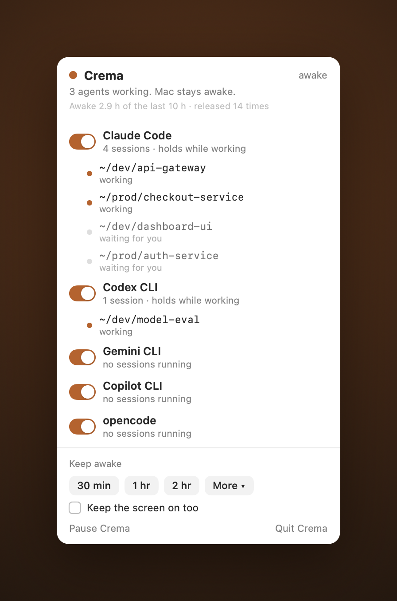

# Crema

**Keep your Mac awake while your AI coding agents work, then release the hold after they go quiet.**

<p align="center"></p>

Crema is a menu bar app for macOS. It is a `caffeinate` you can actually see, and an [Amphetamine](https://apps.apple.com/us/app/amphetamine/id937984704) alternative built for a newer problem: you now run coding agents all day, in a dozen terminals, and "is anything still running" is a question you ask constantly.

The old keep-awake tools answer the wrong question. They know whether *you* clicked a toggle. They do not know whether Claude Code is mid-turn in one window while three others sit waiting for your next prompt. Crema does.

Crema never asks for your password. It installs no sudo rule, no background helper and no agent hooks. It watches processes, reads the transcripts Claude Code already writes, and makes the same keep-awake call `caffeinate` makes. `brew install` is the whole setup.

> How do I keep my Mac awake while Claude Code (or Codex, or Gemini) runs, without leaving it awake all night? That is the question Crema exists to answer.

## What it does

- **Shows its receipts.** A rolling ledger in the popover: how long Crema actually held the Mac awake over the last day, and how many times it let go. A keep-awake app should be able to prove it lets your Mac sleep.
- **Holds the Mac awake while it detects agent activity.** After every agent reads as waiting, a 10-minute grace window runs out and Crema releases its automatic hold. A manual hold, the screen switch, or a running batch rule can keep it awake longer.
- **Shows working vs waiting.** The popover lists each detected session, its folder, and its estimated activity. The menu bar count is sessions currently marked working.
- **Hold it yourself too.** All agents finished but you are still reading the diff? Keep the Mac awake for 30 minutes, 1, 2, 3, 4, 6, or 8 hours, or until you turn it off. The screen switch keeps both the Mac and its display awake until you switch it off, even after a timer ends.
- **Pause.** One click releases Crema's holds immediately, even during a scan. The Mac sleeps on its normal schedule until you resume. Timers and the screen switch also take effect during a scan.
- **Watches batch jobs too.** The built-in ffmpeg rule holds while the process runs. Adding another process currently requires a source change to [`Rule.defaults()`](Sources/CremaCore/Rule.swift). There is no custom-rule editor in the app yet.

Claude Code ships as a preset that is on by default. Nothing to configure before it is useful.

## See it work

<p align="center"></p>

## Why not just use caffeinate, Amphetamine, KeepingYouAwake, or Adrafinil?

| Tool | What it does | What it misses |
| --- | --- | --- |
| [`caffeinate`](https://ss64.com/mac/caffeinate.html) | The built-in CLI. Holds a power assertion until you kill it. | Invisible. You forget which terminal ran it, and you cannot see the rest. |
| [Amphetamine](https://apps.apple.com/us/app/amphetamine/id937984704) | Rich triggers, including "while an app runs." | Manages only its own assertion. No per-session agent view. |
| [KeepingYouAwake](https://github.com/newmarcel/KeepingYouAwake) | A clean menu bar toggle over caffeinate. | A toggle, not a monitor. It cannot tell working from waiting. |
| [Caffeine](https://www.caffeine-app.net/) | The 2006 original. On or off. | Same. |
| [Adrafinil](https://github.com/kageroumado/adrafinil) | The closest match. Knows when an agent turn starts and ends, and can keep a closed lid awake. | The turn signal comes from hooks it installs into each agent, and the closed-lid mode runs `pmset disablesleep` as root. |

The first four cannot tell an agent working from one waiting for you, which for an all-day agent user is the whole question. Adrafinil can, and it is the pick if you want the lid shut. Crema gets there by watching, with no root and nothing installed into your agents. The cost is that watching is an estimate (see [Limits](#limits)).

## Leave the lid open

On battery, macOS sleeps a MacBook when the lid closes, whatever app-level holds say. Getting past that takes root, which is why Crema does not try. A shut laptop that stays awake also tends to end up in a bag or on a bed with an agent still running and nothing cooling it. Apple asks for [a stable surface with good ventilation](https://support.apple.com/en-us/102336).

An agent run does not need the lid shut. Leave the laptop open on the desk and let the screen sleep. Crema holds only the system awake unless you turn on the screen switch. Clamshell mode (lid closed, external display and power) works as usual.

## Install

Via Homebrew:

```bash
brew install --cask karanb192/tap/crema
```

Builds are Developer ID signed and notarized, so the app opens first try with no
Gatekeeper hoops. Apple Silicon only.

Or build from source (Xcode 15+ / Swift 5.9+):

```bash
git clone https://github.com/karanb192/crema.git
cd crema
make run      # builds a release .app and launches it
```

The cup appears in your menu bar. There is no Dock icon and no window; it is a background menu bar app.

## How it works

- **Power** uses [`IOPMAssertionCreateWithName`](https://developer.apple.com/documentation/iokit/1557134-iopmassertioncreatewithname), the same call `caffeinate` makes. Crema holds one system-sleep assertion and, when the screen switch is on, one display-sleep assertion.
- **Turn detection** estimates activity from CPU use and recent transcript writes. Claude Code gets the transcript signal when its working directory belongs to one watched agent process. Shared directories and other agents use CPU activity. Both signals can miss long, quiet steps. A short sticky window keeps brief pauses from changing the state repeatedly.
- **Attribution** walks each process for its working directory, so a session shows as its folder, not a bare pid.

The engine lives in `CremaCore` and is covered by unit tests, including an integration test that creates a real assertion and confirms macOS lists it via `pmset -g assertions`. App tests hold a scan open to check that Pause, timers, the screen switch, and rule changes survive its completion. The awake ledger records confirmed system holds, including when macOS refuses a requested hold.

```bash
make test
```

## Agents supported

Presets ship for the agents below and are enabled by default. Claude Code uses recent transcript writes when its working directory is unambiguous. The others use CPU activity. Custom agent rules added in source also use CPU activity.

| Agent | Process | Preset |
| --- | --- | --- |
| [Claude Code](https://github.com/anthropics/claude-code) | `claude` | yes |
| [Codex CLI](https://github.com/openai/codex) | `codex` | yes |
| [Gemini CLI](https://github.com/google-gemini/gemini-cli) | `gemini` | yes |
| [Copilot CLI](https://github.com/github/copilot-cli) | `copilot` | yes |
| [opencode](https://github.com/sst/opencode) | `opencode` | yes |
| Anything else | any | custom rule |

## Limits

Known gaps, stated here so you do not find them the hard way:

- Working and waiting are estimates. A long network wait or quiet tool call can read as waiting, including for Claude Code. Multiple watched agents in one directory use CPU activity only. Use a manual hold when a long unattended job must stay awake.
- Closing the lid on battery sleeps the Mac, by design. Lid open or clamshell mode are the supported shapes. See [Leave the lid open](#leave-the-lid-open).
- Crema only sees its own holds. A stray hand-started caffeinate or another app's assertion is invisible to it for now; the radar for that is the top roadmap item.
- Apple Silicon only, macOS 13+.

## Status

Early but solid. The power engine and detection are unit-tested and in daily use; releases are Developer ID signed and notarized. Next up: precise turn signals for Codex, Gemini, Copilot and opencode, and a radar for power assertions Crema does not own (that stray hand-started `caffeinate`).

## License

MIT. See [LICENSE](LICENSE).
